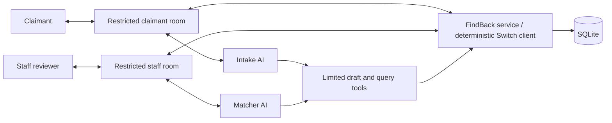

# FindBack — recommended technical design

## Current extension — historical discovery before verification

The user's large-university clarification supersedes the original text-first priorities below. Reuse the implemented domain service and scoped rooms. Add the discovery path rather than replacing the verified return workflow. This section is a design, not an implementation claim.

- Add a source-linked found-report catalogue: group/channel, post, author, actual post time, stated found time/place, attachment references/digests, extracted public characteristics, uncertainty, current source revision, and custody/status. Link it to canonical inventory only when the librarian confirms custody. A model-interpreted found post cannot authorize inventory or release.
- Backfill authenticated group history with pagination and a persistent checkpoint, then ingest new posts incrementally. Reconcile edits/deletions and duplicate delivery. Missing attachments remain visibly incomplete; they are not silently replaced with invented observations. Historical ingestion needs its own authenticated paging path, rather than assuming the runtime's latest-200-post verification window covers the archive.
- Interpret photo attachments through a constrained multimodal inference path and retain visible observations with their source. Caption-only matching is not evidence of image understanding. Do not expand model privileges merely to accept image input.
- Search a bounded public catalogue using normalized descriptions/synonyms, image-derived attributes and place/time context. Uncertain or missing color/time/location should not become an unjustified hard exclusion. Return a small shortlist; send only relevant candidates into model comparison rather than the entire inventory.
- Candidate cards carry actual public thumbnails, source dates/locations and working original-message links. Private facts and claimant evidence never enter this public index. Similar reports remain distinct; replay deduplication must not merge two similar objects.
- Bind selection to the exact source/candidate message. Ask for clarification when a standalone "mine" has no clear reference. Provision or reuse an isolated case from verified identity; preserve authenticated librarian decisions and revision-bound reservation/handover operations.

SQLite and a bounded catalogue are a reasonable first implementation. Introduce further search infrastructure only if measured retrieval requires it. Acceptance must include a match older than 200 posts, an image-led report, a similar distractor, changed wording, no match, source links and restart-safe ingestion.

## Original architecture reference

This is a proposed design. No API integration, privacy boundary, or runtime behavior has been verified for FindBack yet.

## Smallest practical architecture

Use Python 3.11+ and SQLite for the domain service, with a small FastAPI adapter only if HTTP tools are useful. Use the user's existing Switch-supported agent provider for Intake and Matcher. A React dashboard is unnecessary for the first version.

The FindBack service is the authority for records and transitions. Agents can extract information, ask questions, compare, and propose. A staff-authorized command, authenticated by the service, performs reservation or release. Claimant confirmation is likewise tied to the enrolled claimant.

## Switch integration spike comes first

Record Console and Core versions. Start a server with bundled Mattermost and connect a real model-backed agent. Check the installed documentation and actual event payload before writing the adapter.

Current official protocol guidance describes WebSocket events and HTTP operations. Registration and agent keys are separate. For a custom client, persist its identity and connection ID, answer heartbeats, and resume from the documented cursor. Keep protocol handling in an adapter, not in business rules. Do not copy an older SSE example without checking compatibility.

Verify these capabilities on the installed version:

- Posting and reading a threaded message in the intended room.
- Mapping human and agent senders to stable, authenticated identities.
- Enforcing configured addressing rules.
- Creating or manually provisioning restricted staff and claimant rooms.
- Showing that an unrelated claimant and the Intake agent cannot read staff-only evidence.
- Receiving an actual staff command without trusting the model's paraphrase of it.

See the [official protocol](https://docs.switchagents.ai/switch-rooms/internals/agent-protocol) and [responsibility model](https://docs.switchagents.ai/switch-rooms/resources/shared-responsibility). Room controls do not establish a filesystem or process sandbox. Scope provider tools, working folders, and credentials separately.

## AI roles and tool access

| Role | May access | May propose | Must not be able to do |
| --- | --- | --- | --- |
| Intake | Its claimant's case and coarse candidate information | Report drafts and broad follow-up questions | Read item secrets, other claims, or approve a release. |
| Matcher | Staff-only inventory and submitted case evidence | Ranked candidates and comparison reports | Authorize ownership or fabricate human evidence. |
| FindBack service | Canonical records and trusted Switch events | Deterministic receipts and next-state notices | Treat agent text as a human approval. |

If agent tools run through MCP, use separate configurations for Intake and Matcher. The tool boundary must enforce case and room scopes; a prompt alone is insufficient. Agents should not receive the service's authorization credentials or unrestricted database writes.

## Data model

Keep these records small and explicit:

| Record | Essential fields |
| --- | --- |
| Item | ID, category, brand/model if known, color, found place/time, private distinguishing facts, status, revision. |
| Claim | ID, enrolled claimant ID, case room ID, human-confirmed description, status, selected item if any, revision. |
| Evidence | ID, claim/item association, text or local attachment reference, authenticated source message ID, source actor ID/kind, timestamp. |
| Review | Claim ID/revision, item ID/revision, comparison, required missing information, staff decision and reason. |
| Approval | Claim ID/revision, item ID/revision, authorized staff ID, source event ID, time, validity. |
| Return | Reservation reference, staff handover event, claimant receipt event, final receipt ID/time. |
| Audit event | Unique source event ID, action, actor, affected records/revisions, previous/next state, result. |

Keep identifying facts separate from public/coarse summaries. Route output using explicit enrolled room IDs. Never accept a model-supplied arbitrary destination for secret evidence.

## Suggested internal operations

These are FindBack domain operations, not claims about existing Switch endpoints:

- Draft and confirm a report.
- Register or correct a found item.
- Search coarse inventory and propose candidates.
- Record claimant evidence from a trusted event.
- Produce a staff comparison for an exact case revision.
- Approve or reject a claim/item pair.
- Cancel a reservation.
- Record staff handover.
- Record claimant receipt.
- Read an authorized case status and audit trail.

An LLM tool may draft a proposed action. Privileged operations must derive actor identity from a verified event/session, never an `approved_by` string in tool arguments.

## State and concurrency

Items: `AVAILABLE → RESERVED → RETURNED`. A cancelled reservation returns an item to `AVAILABLE`. Staff can also mark an unclaimed item `WITHDRAWN` with a reason.

Claims: `OPEN → NEEDS_INFO → UNDER_REVIEW → APPROVED → HANDOVER_RECORDED → RETURNED`. Allow explicit `REJECTED` and `CANCELLED` outcomes. Reopened or corrected evidence requires a fresh review where it affects the approved basis.

Approval is bound to both record revisions. In one database transaction, check staff authorization, current revisions, item availability, and claim eligibility; then create the reservation and audit event. Enforce one active reservation per item at the database level. Duplicate delivery of the same source event returns the existing result.

Record staff handover before accepting claimant receipt for closure. Replaying either command cannot create a second return. Restarting the service must preserve approvals, reservations, and message deduplication.

## Matching and evidence

Start with deterministic category/place/time filters, then let the Matcher explain candidates using known facts. Add semantic or visual matching only if it improves the demonstrated case.

Store evidence as a claimant assertion or staff observation, not as established truth merely because a model extracted it. Verification questions must not disclose the expected answer. Staff makes the ownership judgment; code enforces that the correct staff actor approved the exact records being acted on.

## Proposed implementation layout

Use modules for domain/state, repository/storage, matching, authorization, Switch transport, output routing, agent tools, fixtures, and tests. Keep transport-independent domain tests runnable without Switch or model keys. Add a separate opt-in real-Switch integration check. This layout is guidance, not existing files.
